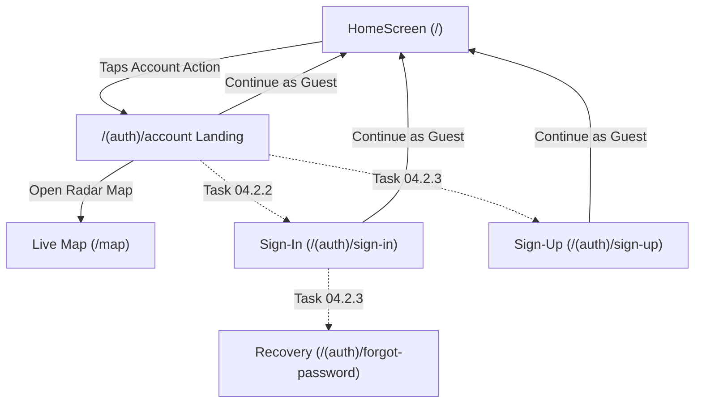

# Waymark Mobile — Feature 04.2: Authentication UI Architecture & Specifications

**Document Version:** 1.0.0
**Status:** Approved Architecture Specification
**Author:** Janu (`januka-karunakaran` | `karunakaranj.23@uom.lk`)
**Reviewer:** Sathu (`Sathurjanv23` | `sathurjanv.23@uom.lk`)
**Target Application:** Waymark Mobile (`waymark-mobile` / Expo SDK 52 / React Native / TypeScript)
**Date:** November 20, 2026

---

## 1. Executive Summary & Purpose

Feature 04.2 implements the presentation and interaction layer for Waymark Mobile's authentication system. Building on the foundational contracts, secure session storage, and reactive context established in Feature 04.1, Feature 04.2 provides a cohesive, futuristic, and accessible user interface for account discovery, sign-in, registration, and credential recovery.

In accordance with Waymark's Zero-Deception and Safety Policies:
1. **No Simulated Authenticated State:** The UI never fakes successful login or registration while identity services remain unconfigured (`UnavailableAuthService`).
2. **Unbroken Guest Access:** All five core public transit navigation tabs (`/`, `/map`, `/journey`, `/oracle`, `/comfort`) remain completely accessible to guest travelers without mandatory login prompts.
3. **Hardware & Platform Security:** Passwords and secret credentials are never stored in plain text, logged, or serialized into navigation parameters.

---

## 2. Route Architecture & Expo Router Structure

Waymark Mobile utilizes Expo SDK 52 and Expo Router 4 file-based routing. To prevent route collision with the root URL (`(tabs)/index.tsx`), authentication screens are encapsulated within a dedicated route group `(auth)`:

```text
mobile/app/
├── _layout.tsx                     # Root stack mounting AuthProvider & SafeAreaProvider
├── (tabs)/                         # 5 core public multimodal navigation tabs
│   ├── _layout.tsx                 # Bottom tab navigator
│   ├── index.tsx                   # Route: / (Home - Planetary Transit Network)
│   ├── map.tsx                     # Route: /map (Live Vector Map)
│   ├── journey.tsx                 # Route: /journey (Mission Routes)
│   ├── oracle.tsx                  # Route: /oracle (AI Concierge)
│   └── comfort.tsx                 # Route: /comfort (Sensory & Telemetry)
│
└── (auth)/                         # Authentication & Account route group
    ├── _layout.tsx                 # Dedicated Auth Stack (headerShown: false, abyssVoid bg)
    ├── account.tsx                 # Route: /(auth)/account (Landing & service status)
    ├── sign-in.tsx                 # Route: /(auth)/sign-in (Task 04.2.2)
    ├── sign-up.tsx                 # Route: /(auth)/sign-up (Task 04.2.3)
    └── forgot-password.tsx         # Route: /(auth)/forgot-password (Task 04.2.3)
```

### Route Design Principles
- **No Route Collision:** `(auth)` does NOT declare an `index.tsx` route to avoid ambiguous routing conflicts with `(tabs)/index.tsx`.
- **Public Entry Point:** A subtle `HeaderAction` account avatar trigger is placed in the `HomeScreen` header, navigating explicitly to `/(auth)/account`.
- **Clean Stack Hierarchy:** Child routes inside `(auth)` use native stack animations without creating duplicate screen headers.

---

## 3. Shared Authentication Component System

To maintain visual harmony with the Waymark 2100 avionics design language, shared authentication components are housed in `mobile/src/features/auth/components/`:

| Component | File Path | Core Responsibilities |
|---|---|---|
| `AuthScreenShell` | `.../components/AuthScreenShell.tsx` | Safe-area edge enforcement, keyboard avoidance, responsive max width constraint ($480\text{ pt}$ centered for tablets), dark `#070A0F` backdrop, and accessible back navigation. |
| `AuthBrandHeader` | `.../components/AuthBrandHeader.tsx` | Waymark 2100 brand badge with rotated navigational compass, system status pill (`SYS.GUEST` / `SYS.READY`), semantic heading (`accessibilityRole="header"`), and subtitle. |
| `AuthFormField` | `.../components/AuthFormField.tsx` | Reusable field combining `FormField`, `AppInput`, and `AppPasswordInput` with password visibility toggling, accessible labels, input sanitization, and error alerts. |
| `AuthStatusNotice` | `.../components/AuthStatusNotice.tsx` | Accessible alert card (`variant="info" | "warning" | "error" | "unavailable"`) displaying truthful provider availability, sanitised error messages, and optional action triggers. |

---

## 4. Guest Mode & Navigation Flow

Waymark is fundamentally an avionics transit navigation guide. High-value discovery must never be locked behind a mandatory login barrier:



1. **Unconstrained Public Exploration:** Users can navigate freely between all 5 tabs without logging in.
2. **Predictable Back Navigation:** Pressing back or "Continue as Guest" always safely returns travelers to the public transit interface without navigation traps or loops.
3. **No Active Broken Links:** Links to unfinished features (Sign-In, Sign-Up) are never exposed as active clickable routes until the corresponding task is merged into `main`.

---

## 5. Service Readiness & Truthful Degradation

The application currently relies on `UnavailableAuthService`:
- `getServiceReadiness()` returns `'not_configured'`.
- `signIn()` and `signUp()` return `{ success: false, error: AuthError.notConfigured() }`.
- `getCurrentSession()` resolves to `null`.

### UI Presentation Rules
- When `serviceReadiness === 'not_configured'`, the `AccountScreen` displays an `AuthStatusNotice` with `variant="unavailable"`.
- It explicitly informs the user that external authentication servers are in standby, and confirms that planetary routing, vector mapping, and concierge features are 100% active in Guest mode.
- Under no circumstances will the UI claim an account was created or logged in until a genuine identity provider confirms authorization.

---

## 6. Sign-In Screen Architecture & Validation (Task 04.2.2)

Implemented in `mobile/app/(auth)/sign-in.tsx`:

### Form Validation Rules
- **Email Validation:**
  - Mandatory: empty or whitespace-only inputs are rejected with `"Email address is required."`.
  - Format: checked against RFC-compliant standard regex `^[^\s@]+@[^\s@]+\.[^\s@]+$`.
  - Length Boundary: clamped to a maximum of 254 characters (RFC 5321).
  - Sanitization: surrounding whitespace is trimmed before validation and dispatch.
- **Password Validation:**
  - Mandatory: empty inputs are rejected with `"Password is required."`.
  - Length Boundary: clamped to a maximum of 128 characters.
  - Policy Delegation: complex password strength requirements are not arbitrarily imposed on sign-in (credential verification belongs to the trusted provider).
- **Concurrency & Re-entrancy Protection:**
  - Submissions are locked during `status === 'authenticating'` or local `isSubmitting`.
  - Duplicate button presses are ignored while requests are in-flight.

### Security & Privacy Safeguards
1. **Password Masking:** Defaults to `secureTextEntry={true}` using `AppPasswordInput`. Show/Hide toggle exposes explicit accessible descriptions (`"Show password"` / `"Hide password"`).
2. **Zero Storage Persistence:** Passwords exist solely in ephemeral React state during component lifecycle and are completely excluded from persistent storage, route parameters, and analytics.
3. **Telemetry Scrubbing:** Spies on `console.log`, `info`, `warn`, and `error` confirm that passwords and tokens are never leaked into console logging.
4. **Honest Standby Mode:** When `serviceReadiness === 'not_configured'`, sign-in submissions are disabled and an `AuthStatusNotice` banner truthfully explains that identity servers are in standby.

---

## 7. Registration & Account Recovery Architecture (Task 04.2.3)

Implemented in `mobile/app/(auth)/sign-up.tsx` and `mobile/app/(auth)/forgot-password.tsx`:

### Sign-Up Form Specifications & Validation
- **Display Name Validation:**
  - Optional field allowing travelers to define their public navigator handle.
  - Length boundary: clamped to maximum 50 characters.
  - Trimmed upon submission; omitted from payload if whitespace-only.
- **Email Validation:**
  - Mandatory, validated against standard RFC syntax `^[^\s@]+@[^\s@]+\.[^\s@]+$`.
  - Max length: 254 characters.
- **Password & Confirmation Validation:**
  - Mandatory password with minimum 8 characters and maximum 128 characters.
  - Confirmation password must match password exactly (`Passwords do not match.`).
  - Inputs mask characters by default with accessible visibility toggles (`AppPasswordInput`).
- **Registration Dispatch & Truthful Degradation:**
  - When `serviceReadiness === 'not_configured'`, submission is strictly disabled and an `AuthStatusNotice` (`variant="unavailable"`) informs travelers that registration services are in standby.
  - When configured, delegates directly to `useAuth().signUp(...)` and transitions to `/(tabs)` upon success.

### Account Recovery (Forgot Password) Specifications
- **Client Input & Format Verification:**
  - Collects account email address with standard email syntax and length validation.
- **Standby Mode & Truthful Presentation:**
  - When unconfigured, submission is disabled with an `AuthStatusNotice` (`variant="unavailable"`) explaining that recovery services are in standby.
  - No synthetic recovery tokens or fake emails are dispatched.
- **Account Enumeration Protection:**
  - When active, recovery submissions render an enumeration-resistant confirmation notice (`"If an account exists for this email address, password recovery instructions have been sent."`) without revealing whether the email is registered in the database.

---

## 8. Expo SDK 52 Compatibility & Conventions

- **Expo Router 4:** File-based routing using typed routes (`Href`).
- **No Experimental SDK 53 APIs:** Does not use `Stack.Protected` or other unsupported constructs.
- **Theme Tokens:** Reuses Waymark 2100 dark theme tokens:
  - Background: `abyssVoid` (`#070A0F`)
  - Card Surface: `deckInk` (`#0D1117`)
  - Border: `border` (`rgba(184, 194, 217, 0.16)`)
  - Accent Gold: `beaconGold` (`#FFC629`)
  - Text: `textPrimary` (`#DFE2EB`), `textSecondary` (`#A9B2C3`), `textMuted` (`#7E8CA7`)
- **Accessibility:** Touch targets $\ge 44 \times 44\text{ pt}$, `accessibilityRole="button"` / `"header"` / `"alert"`, dynamic font scaling enabled (`allowFontScaling={true}`).

---

## 9. Feature 04.2 Implementation Roadmap

| Subtask | Scope | Commit Message | PR Target | Status |
|---|---|---|---|---|
| **04.2.1** | Auth Navigation & Shared Layout | `feat(mobile): establish auth screen navigation and layout` | `main` | **Merged (PR #45)** |
| **04.2.2** | Sign-In Screen & Validation | `feat(mobile): implement secure sign-in screen and validation` | `main` | **Merged (PR #46)** |
| **04.2.3** | Sign-Up & Password Recovery UI | `feat(mobile): add registration and account recovery screens` | `main` | **Complete / In Review** |
| **04.2.4** | Accessibility, Security & QA | `test(mobile): complete authentication UI integration QA` | `main` | Next Task |
