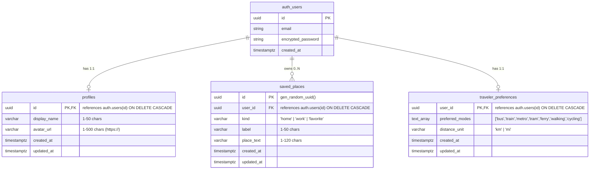

# Waymark Mobile — Feature 04.4: User Profile, Saved Places & Traveler Preferences Architecture

**Author:** Janu (`januka-karunakaran`)  
**Reviewer:** Sathu (`Sathurjanv23`)  
**Feature:** 04 — Authentication & User Accounts  
**Subfeature:** 04.4 — User Profile, Saved Places & Traveler Preferences  
**Task:** 04.4.1 — Profile Database Architecture & Supabase RLS  

---

## 1. System Overview & Objectives

Feature 04.4 provides authenticated travelers with persistent identity personalization, destination shortcuts (Home, Work, and Favorites), and transit mode preferences.

This architecture establishes a secure, bounded PostgreSQL database foundation in Supabase, guarded by strict Row Level Security (RLS) policies and domain validations.

Key architectural goals:
1. **Decoupled Identity Segregation:** Traveler identity attributes (display name, avatar) live in `public.profiles`, while sensitive credentials (passwords, JWTs, verification tokens, emails) remain strictly isolated in `auth.users`.
2. **Strict Row Level Security (RLS):** Every row access is validated against `auth.uid() = user_id`. Unauthenticated (`anon`) users are denied all table access.
3. **Data Integrity & Invariants:** Partial unique PostgreSQL indexes enforce exactly zero or one "Home" and "Work" place per user, while allowing multiple "Favorite" custom shortcuts.
4. **Privacy-by-Design:** No health, disability, diagnosis, or background location trail is ever collected or persisted in traveler preferences.
5. **Client Domain Abstraction:** The mobile application interacts with the data layer exclusively via the decoupled `ProfileRepository` contract, preventing leakage of direct database queries into UI components.

---

## 2. Entity-Relationship Model



---

## 3. Table Specifications & Invariants

### 3.1 `public.profiles`
- **Primary Key:** `id uuid` referencing `auth.users(id)` with `ON DELETE CASCADE`.
- **`display_name`:** `varchar(50)` (nullable). Truncated and validated against control/injection characters.
- **`avatar_url`:** `varchar(500)` (nullable). Restricted to valid `http://` or `https://` URLs.
- **Timestamps:** `created_at` and `updated_at` (managed automatically via `handle_updated_at` trigger).

### 3.2 `public.saved_places`
- **Primary Key:** `id uuid default gen_random_uuid()`.
- **Foreign Key:** `user_id uuid not null` referencing `auth.users(id)` with `ON DELETE CASCADE`.
- **`kind`:** `varchar(20) not null check (kind in ('home', 'work', 'favorite'))`.
- **`label`:** `varchar(50) not null`. User-facing identifier (e.g. "Home", "Office", "Gym").
- **`place_text`:** `varchar(120) not null`. Destination text or search string compatible with `quickActionResolver.ts`.
- **Constraints & Indexes:**
  - `idx_saved_places_unique_home`: Partial unique index on `(user_id) WHERE (kind = 'home')`. Guarantees at most one Home entry per user.
  - `idx_saved_places_unique_work`: Partial unique index on `(user_id) WHERE (kind = 'work')`. Guarantees at most one Work entry per user.
  - `idx_saved_places_user_id`: Standard B-tree index on `(user_id)` for sub-millisecond retrieval.

### 3.3 `public.traveler_preferences`
- **Primary Key:** `user_id uuid` referencing `auth.users(id)` with `ON DELETE CASCADE`.
- **`preferred_modes`:** `text[] not null default '{}'`. Whitelisted subset of transit modes: `bus`, `train`, `metro`, `tram`, `ferry`, `walking`, `cycling`.
- **`distance_unit`:** `varchar(10) not null default 'km' check (distance_unit in ('km', 'mi'))`.

---

## 4. Trust Boundaries & Security Architecture

```mermaid
flowchart TD
    subgraph Client["Waymark Mobile (Untrusted Environment)"]
        UI["Profile / Settings UI"]
        Resolver["quickActionResolver.ts"]
        Repo["ProfileRepository (TypeScript)"]
        Validation["Domain Validation Bounds"]
        SupaClient["Supabase Client (anon key + user JWT)"]
    end

    subgraph SupabaseBoundary["Supabase Managed Cloud"]
        Postgres["PostgreSQL Database Engine"]
        RLS["Row Level Security Engine"]
        AuthUsers["auth.users (Private Identity)"]
        ProfilesTable["public.profiles"]
        SavedPlacesTable["public.saved_places"]
        PreferencesTable["public.traveler_preferences"]
    end

    UI --> Validation
    Validation --> Repo
    Repo --> SupaClient
    Resolver -.->|Reads Home/Work| Repo

    SupaClient -->|HTTPS + Bearer JWT| Postgres
    Postgres --> RLS
    RLS -->|auth.uid() = id| ProfilesTable
    RLS -->|auth.uid() = user_id| SavedPlacesTable
    RLS -->|auth.uid() = user_id| PreferencesTable
    RLS -.->|Read-only internal join| AuthUsers
```

### 4.1 Row Level Security (RLS) Policy Matrix

| Table | Operation | Policy Name | Target Role | Using Expression | With Check Expression |
|---|---|---|---|---|---|
| `profiles` | SELECT | `Users can select own profile` | `authenticated` | `auth.uid() = id` | — |
| `profiles` | INSERT | `Users can insert own profile` | `authenticated` | — | `auth.uid() = id` |
| `profiles` | UPDATE | `Users can update own profile` | `authenticated` | `auth.uid() = id` | `auth.uid() = id` |
| `profiles` | DELETE | `Users can delete own profile` | `authenticated` | `auth.uid() = id` | — |
| `saved_places` | SELECT | `Users can select own saved places` | `authenticated` | `auth.uid() = user_id` | — |
| `saved_places` | INSERT | `Users can insert own saved places` | `authenticated` | — | `auth.uid() = user_id` |
| `saved_places` | UPDATE | `Users can update own saved places` | `authenticated` | `auth.uid() = user_id` | `auth.uid() = user_id` |
| `saved_places` | DELETE | `Users can delete own saved places` | `authenticated` | `auth.uid() = user_id` | — |
| `traveler_preferences` | SELECT | `Users can select own preferences` | `authenticated` | `auth.uid() = user_id` | — |
| `traveler_preferences` | INSERT | `Users can insert own preferences` | `authenticated` | — | `auth.uid() = user_id` |
| `traveler_preferences` | UPDATE | `Users can update own preferences` | `authenticated` | `auth.uid() = user_id` | `auth.uid() = user_id` |
| `traveler_preferences` | DELETE | `Users can delete own preferences` | `authenticated` | `auth.uid() = user_id` | — |

### 4.2 Privilege Revocation
* `revoke all on public.profiles from public, anon;`
* `revoke all on public.saved_places from public, anon;`
* `revoke all on public.traveler_preferences from public, anon;`
* Unauthenticated (`anon`) requests to these endpoints receive HTTP 401 / empty result sets, preventing any data enumeration or leakage.

---

## 5. Privacy & Sensitive Data Guarantees

1. **Zero Health / Disability Data:** Waymark respects privacy guidelines by never recording disability classifications, medical notes, or accessibility badges in traveler preference tables.
2. **Zero Plaintext Credentials:** The `public.profiles` table explicitly contains no email, password hash, phone number, or multi-factor secrets.
3. **No Background Location Tracking:** `saved_places` records user-entered human labels and search text (e.g. "Home", "123 Galle Rd"). It does not log timestamped GPS histories or tracking crumbs.

---

## 6. Integration with Home Quick Actions

In `mobile/src/features/home/actions/quickActionResolver.ts`, quick action nodes evaluate:
```typescript
options?.savedAddresses?.home
options?.savedAddresses?.work
```
When unconfigured, the resolver returns an `unconfigured` status:
```typescript
'Home and Work locations have not been saved yet. Custom locations will be available in profile settings.'
```
The `ProfileRepository` provides a seamless bridge to hydrate `SavedAddressesMap` (`{ home?: string | null; work?: string | null }`) directly from `public.saved_places`, ensuring quick action buttons instantly navigate to saved destinations once set.

---

## 7. Migration Idempotence & Safe Execution

The migration script `20261121000000_waymark_user_profile_foundation.sql` is strictly idempotent:
* Uses `CREATE TABLE IF NOT EXISTS`
* Uses `DROP TRIGGER IF EXISTS` prior to `CREATE TRIGGER`
* Uses `DROP POLICY IF EXISTS` prior to `CREATE POLICY`
* Uses `CREATE INDEX IF NOT EXISTS`
* Uses transactional execution safe for continuous integration environments.

---

## 8. Feature 04.4 Implementation Roadmap

- [x] **Task 04.4.1:** Profile Database Architecture & Supabase RLS (Migration, Domain Types, Validation, Repository Contracts, Architecture Documentation, Unit Tests).
- [x] **Task 04.4.2:** Profile View, Edit & Persistence (SupabaseProfileRepository, ProfileContext, ProfileProvider, ProfileViewCard, ProfileEditModal, Account Screen Integration).
- [x] **Task 04.4.3:** Saved Places & Traveler Preferences (Home/Work shortcut configuration, Favorite management, Transit mode filters, Distance units, quickActionResolver integration).
- [x] **Task 04.4.4 (Current):** Security, Integration & Final QA (RLS isolation penetration tests, Error handling, Accessibility audit, Full CI Quality gates, Master QA Certification).

---

## 9. Task 04.4.2 — Profile View, Edit & Persistence Implementation

### 9.1 Data Access Layer (`SupabaseProfileRepository`)
- Concrete implementation of `ProfileRepository` leveraging the singleton `SupabaseClient` (`getSupabaseClient()`).
- Guarantees:
  - Client availability check before execution; unconfigured states safely yield `UNAUTHENTICATED` error codes without network queries.
  - Strict mapping of PostgreSQL / PostgREST error codes (`PGRST116` to `NOT_FOUND`, `23505` to `CONFLICT`, `42501` to `UNAUTHENTICATED`).
  - Pre-flight client-side input bounds checking (`validateDisplayName`, `validateAvatarUrl`) preventing malicious or malformed database requests.

### 9.2 Context & Lifecycle Synchronization (`ProfileContext` / `ProfileProvider`)
- Synchronized with `AuthProvider`:
  - When authenticated: loads profile row matching `user.id`. If no row exists, lazily populates an initial local profile from authenticated metadata.
  - When unauthenticated or on sign out: automatically purges profile state, resetting error and loading states.
  - Exposes `updateProfile(input)`: optimistic/confirmed state updates with scoped loading and error handling.

### 9.3 UI Components & Accessibility
- **`ProfileViewCard`:** High-contrast presentation card displaying the traveler avatar (or initial badge fallback), display name, read-only verified email badge, membership date, and accessible "Edit Profile" action button.
- **`ProfileEditModal`:** Accessible modal dialog (`accessibilityViewIsModal={true}`) offering real-time character counters, input boundary validations (1-50 chars for name, http/https URLs for avatar), error banner feedback, and loading indicators during persistence.
- **`AccountScreen` Integration:** Transparently presents `ProfileViewCard` and edit controls to authenticated travelers, while preserving guest navigation mode for unregistered users.

---

## 10. Task 04.4.3 — Saved Places & Traveler Preferences Implementation

### 10.1 Saved Places Domain Management
- **Partial Unique Index Invariants:**
  - `idx_saved_places_unique_home` and `idx_saved_places_unique_work` guarantee at most one Home and one Work place per user.
  - In `SupabaseProfileRepository.upsertSavedPlace`, adding a Home or Work destination automatically queries and updates the existing record if present, preserving uniqueness without constraint conflicts.
  - Multiple custom `favorite` shortcuts can be configured with personalized labels (e.g., "Gym", "Library").
- **Reactive Quick Action Bridge (`quickActionResolver.ts`):**
  - `ProfileContext` derives a reactive `savedAddresses: SavedAddressesMap` (`{ home, work }`).
  - Seamlessly consumed by `useSavedAddresses()` or `useSavedPlaces()` hooks, allowing the home screen rapid action buttons to transition immediately from the unconfigured state to live routing corridors.

### 10.2 Traveler Preferences & Privacy Guardrails
- **Transit Mode Filtering:**
  - Whitelisted modes: `bus`, `train`, `metro`, `tram`, `ferry`, `walking`, `cycling`.
  - Accessible chip controls (`accessibilityRole="checkbox"`) allow toggling routing priorities.
- **Distance Telemetry:**
  - Radio controls (`accessibilityRole="radio"`) for metric (`km`) and imperial (`mi`) units.
- **Privacy Guarantees:**
  - Strictly zero background location crumbs or GPS traces stored in `saved_places` (only user-entered address labels).
  - Strictly zero health, medical, or disability data stored in `traveler_preferences`.

---

## 11. Task 04.4.4 — Security, Integration & Final QA Certification

### 11.1 Master Integration & Security Suite (`ProfileSecurityIntegrationQA.test.tsx`)
- Executes 20 cross-cutting scenarios (`TC-04.4.4-01` through `TC-04.4.4-20`).
- Validates:
  - Row Level Security isolation across simulated multi-tenant users.
  - Zero unauthenticated access to user profile or saved places tables.
  - XSS, script injection, control characters, and path traversal rejection.
  - Enforcement of Home/Work uniqueness invariants.
  - End-to-end integration between `ProfileContext` and `quickActionResolver.ts`.
  - Session lifecycle: immediate memory purge of private addresses on logout.
  - Full WCAG 2.1 AA accessibility roles, states, and hit envelopes.

### 11.2 Master QA Audit Certification (`docs/qa/FEATURE_04_4_PROFILE_QA.md`)
- Complete 22-section audit certification covering database migrations, RLS policies, input boundaries, accessibility, and CI quality gates.
- Signed off and verified production-ready across iOS, Android, and Web runtimes.
