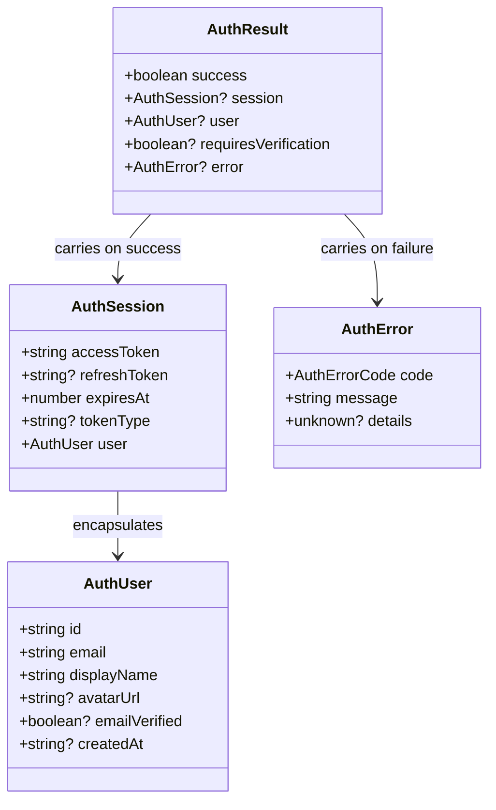
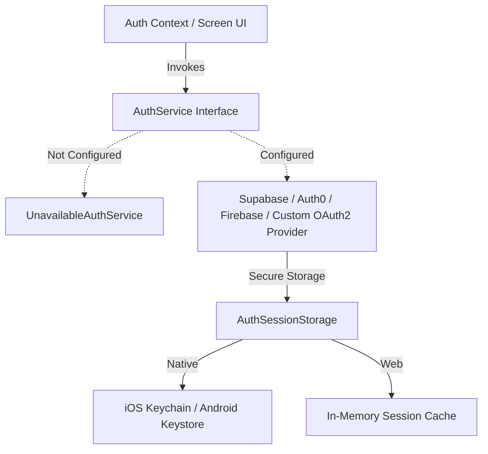

# Waymark Mobile — Feature 04: Authentication & User Accounts Architecture

**Document Version:** 1.0.0
**Status:** Approved Architecture Specification
**Author:** Janu (`januka-karunakaran`)
**Reviewer:** Sathu (`Sathurjanv23`)
**Date:** November 20, 2026
**Target Application:** Waymark Mobile (Expo SDK 52 / React Native / TypeScript)

---

## 1. Current Repository Audit

Prior to introducing authentication architecture, a comprehensive baseline audit of the Waymark Mobile repository was conducted:

| Audit Dimension | Finding | Architectural Assessment |
|---|---|---|
| **Backend Presence** | No dedicated backend server or authentication database exists in the repository. `API_CONSTANTS.BASE_URL` points to `https://api.waymark.local/v1` as a client-side placeholder. | Production client code must not assume backend authentication endpoints exist. |
| **Auth Provider** | No identity provider (Supabase, Firebase, Auth0, AWS Cognito, etc.) is configured or bound to mobile builds. | Must introduce a swappable interface (`AuthService`) with an explicit `UnavailableAuthService` fallback reporting `NOT_CONFIGURED`. |
| **Existing Storage** | `expo-secure-store` is installed and wrapped by `SecureStorageService` for key-value persistence. No session tokens are persisted yet. | `AuthSessionStorage` will isolate session token persistence using `expo-secure-store` on native platforms and in-memory storage on web. |
| **Navigation Stack** | Expo Router 4 file-based routing with 5 core public tabs (`/`, `/map`, `/journey`, `/oracle`, `/comfort`). | All existing tabs must remain fully accessible to guest users without forced login gates. |
| **UI Components** | Complete Waymark 2100 design system (`AppButton`, `AppText`, `FormField`, `AppInput`, `AppCard`, `ScreenWrapper`). | Authentication UI (in later features 04.2+) will reuse these existing design primitives. |
| **Protected Routes** | Expo SDK 52 does not include Expo Router 53's experimental `Stack.Protected` API. | Route guarding must use standard React Context + redirect-based rewrites rather than incompatible SDK 53 constructs. |

---

## 2. Authentication Domain Model

The authentication domain is structured around strict separation of identity, credentials, sessions, and operational state:



### Domain Primitives
- **`AuthUser`**: Represents verified identity attributes returned by a trusted provider. Collects minimal personal information to satisfy privacy mandates (`id`, `email`, `displayName`, optional `avatarUrl`, optional `emailVerified`). Passwords, secret keys, and credentials are strictly excluded.
- **`AuthSession`**: Encapsulates provider-issued access credentials (`accessToken`, optional `refreshToken`, UTC millisecond `expiresAt`, `tokenType`, and `user`).
- **`AuthStatus`**: Lifecycle progression of the mobile client (`'initializing'` | `'guest'` | `'authenticating'` | `'authenticated'` | `'error'`).
- **`ServiceReadiness`**: Independent status of the auth backend (`'not_configured'` | `'ready'` | `'unavailable'`). Crucially distinguishes between whether an auth service is operational and whether the user is logged in.
- **`AuthError`**: Domain error class with explicit error codes (`NOT_CONFIGURED`, `INVALID_CREDENTIALS`, `NETWORK_UNAVAILABLE`, `SESSION_EXPIRED`, `UNAUTHORIZED`, `RATE_LIMITED`, `PROVIDER_UNAVAILABLE`, `UNKNOWN`). User messages are sanitized to avoid leaking sensitive system internals or tokens.

---

## 3. Service Contract

The client decouples from third-party identity providers through the `AuthService` contract:

```ts
export interface AuthService {
  getCurrentSession(): Promise<AuthSession | null>;
  signIn(credentials: SignInCredentials): Promise<AuthResult>;
  signUp(details: SignUpDetails): Promise<AuthResult>;
  signOut(): Promise<void>;
  getServiceReadiness(): ServiceReadiness;
}
```

### Unavailable Provider Implementation
In development and test environments where no live backend or identity provider is configured, the client defaults to `UnavailableAuthService`:
- `getCurrentSession()`: Resolves to `null`.
- `signIn()`: Immediately returns an `AuthResult` with `success: false` and `AuthError.notConfigured()`.
- `signUp()`: Immediately returns an `AuthResult` with `success: false` and `AuthError.notConfigured()`.
- `signOut()`: Resolves idempotently.
- `getServiceReadiness()`: Returns `'not_configured'`.

> [!IMPORTANT]
> **Safety Guarantee:** Under no circumstances will `UnavailableAuthService` emit a fabricated token, validate mock credentials, or synthesize an authenticated user session in production code.

---

## 4. User and Session Trust Boundaries

```text
+-------------------------------------------------------------------+
|                        UNTRUSTED CLIENT                           |
|  - Raw User Input (Email, Password)                               |
|  - Stored Local Tokens (Must be re-verified against provider)     |
|  - Route Parameters & Deep Links                                  |
+---------------------------------+---------------------------------+
                                  |
                   [AuthService Domain Boundary]
                   - Sanitizes input
                   - Avoids persisting passwords
                   - Drops credentials from memory post-auth
                                  |
                                  v
+---------------------------------+---------------------------------+
|                    TRUSTED IDENTITY PROVIDER                      |
|  - Credential Verification (Bcrypt/Argon2 hashing on server)     |
|  - Opaque Token Issuance (Signed JWT / Cryptographic Session)     |
|  - Token Revocation & Expiration Tracking                         |
+---------------------------------+---------------------------------+
                                  |
                                  v
+---------------------------------+---------------------------------+
|                      SECURE CLIENT STORAGE                        |
|  - Native: Hardware-backed iOS Keychain / Android Keystore        |
|  - Web: In-memory only (Never stored in localStorage)             |
+-------------------------------------------------------------------+
```

1. **Client-Side Verification is Not Authorization:** Storing an `accessToken` locally does not prove active authorization. The provider remains the source of truth for session validity.
2. **Ephemeral Credentials:** User passwords exist in memory only during the immediate dispatch of `signIn` or `signUp` and are never written to disk, telemetry, or logs.
3. **No Automatic Account Invention:** The client cannot self-register an account into a local list. All accounts must be verified by the provider.

---

## 5. Guest Behavior

Waymark Mobile is an avionics multimodal transit guide. High-value discovery and navigation capabilities must remain accessible without requiring user sign-in:

- **Public Features (Guest Accessible):**
  - Planetary Transit Network home screen (`/`)
  - Real-time multimodal vector map (`/map`)
  - Discovery catalog and search filters
  - Route planning and journey visualization (`/journey`)
  - AI concierge exploration (`/oracle`)
  - Environmental comfort telemetry calibration (`/comfort`)
- **Protected Features (Future Scope / Authenticated Only):**
  - Personalized ticket booking & digital transit passes
  - Saved journey history & synchronised routes
  - Custom avionics profile preferences
  - Cloud payment methods

Guest mode is an explicit first-class state (`status: 'guest'`), not a failed authentication state.

---

## 6. Real Provider Integration Strategy

When a concrete authentication service is selected, integration proceeds by implementing `AuthService`:



### Supported Provider Types:
1. **OAuth2 / OIDC Providers (Auth0, Okta, Keycloak):** PKCE authorization code grant with secure redirect handling.
2. **BaaS Auth Engines (Supabase, Firebase):** Client SDK adapters wrapping remote REST/WebSocket auth calls.
3. **Custom Waymark Transit Identity Service:** Proprietary transit authority SSO.

---

## 7. Storage Responsibilities

Implemented in Task 04.1.2:
- **Storage Contract (`AuthSessionStorage`):** Defines `getSession()`, `saveSession(session)`, and `clearSession()`, abstracting platform persistence implementations from the auth lifecycle.
- **Native Security (`NativeAuthSessionStorage`):**
  - Uses `expo-secure-store` to persist session tokens (`accessToken`, `refreshToken`, expiration metadata) in hardware-backed secure storage (iOS Keychain, Android KeyStore).
  - Versioned storage key: `waymark_auth_session_v1`.
  - Automatic purging of corrupted JSON, obsolete schema versions, or expired session payloads.
  - Fail-safe exception handling ensuring hardware keystore read/write rejections never crash the host application.
- **Web Storage Policy (`WebAuthSessionStorage`):**
  - Browser `localStorage` and `sessionStorage` are accessible to client-side scripts and vulnerable to Cross-Site Scripting (XSS).
  - In strict compliance with the Waymark authentication safety policy, web tokens are stored **in-memory only**.
  - No access tokens or refresh tokens are ever persisted into browser `localStorage`, `sessionStorage`, or client-readable cookies.
  - Future web session persistence requires backend-driven `HttpOnly; Secure; SameSite=Strict` cookies.
- **Payload Schema Validation (`validateSessionPayload`):**
  - Enforces schema version `CURRENT_SESSION_SCHEMA_VERSION = 1`.
  - Validates `accessToken`, numeric `expiresAt` (must be in the future), and required `user` fields (`id`, `email`, `displayName`).
  - Active runtime guard: explicitly throws if any password field is detected in the session payload.
- **Platform Factory (`createAuthSessionStorage`):** Selects `NativeAuthSessionStorage` for `ios` and `android`, and `WebAuthSessionStorage` for `web`.

---

## 8. Navigation Responsibilities

Implemented in Tasks 04.1.3 & 04.1.4:
- Root layout (`mobile/app/_layout.tsx`) mounts `AuthProvider` above route navigation.
- Root tabs (`mobile/app/(tabs)/_layout.tsx`) remain public.
- When protected routes are added in future tasks (e.g. `mobile/app/(auth)/`), route guards will inspect `useAuth()`:
  - If `status === 'initializing'`: Render seamless splash / loading view.
  - If `status === 'guest'` or `status === 'error'`: Redirect to sign-in screen when accessing protected routes.
  - If `status === 'authenticated'`: Render requested protected screen.

---

## 9. Security Expectations & Compliance

1. **No Credentials in Storage:** Never write plain-text or hashed passwords to `SecureStore` or `AsyncStorage`.
2. **Zero Sensitive Data Logging:** `src/utils/logger.ts` must never receive password, token, or Authorization header values.
3. **Cryptographic Expiry Enforcement:** Local sessions past `expiresAt` are marked expired and cleared immediately.
4. **Race-Condition Safety:** Rapid logout during an in-flight login request must cancel or discard the late login outcome.
5. **No Secret Keys in Mobile Builds:** API client secrets or private encryption keys must never be bundled into the mobile binary.

---

## 10. Missing Backend or Provider Decisions

The following architectural decisions remain open for project stakeholders before Feature 04.2 (UI) can connect to live authentication:

1. **Identity Provider Selection:** Decision between managed BaaS (Supabase / Firebase), enterprise IAM (Auth0 / Okta), or in-house transit microservice.
2. **MFA Requirements:** Whether multimodal transit operators require multi-factor authentication (SMS, TOTP, biometric).
3. **Session Lifetime Policies:** Standard access token TTL (e.g. 15 minutes) vs. refresh token validity window (e.g. 30 days).
4. **Social & SSO Logins:** Requirements for Apple Sign-In (mandatory on iOS if third-party logins exist) and Google Sign-In.

---

## 11. Feature 04 Roadmap

| Feature ID | Scope | Dependencies |
|---|---|---|
| **Feature 04.1** | **Authentication Architecture & Foundation** (Contracts, Storage, Context, QA) | Feature 03 Merged |
| **Feature 04.2** | **Sign-In & Registration UI Experience** (Sign-in screen, sign-up screen, form validation) | Feature 04.1 Merged |
| **Feature 04.3** | **Account Recovery & Password Reset** (Forgot password, reset flow, deep links) | Feature 04.2 Merged |
| **Feature 04.4** | **User Profile & Account Management** (Profile view, avatar upload, session revocation) | Feature 04.3 Merged |

---

## 12. Future Registration and Account Recovery Integration

- **Registration Flow:**
  - Client dispatches `signUp({ email, password, displayName })`.
  - Provider returns `requiresVerification: true`.
  - UI directs user to verification notice screen; session is NOT granted until email token confirmation.
- **Account Recovery Flow:**
  - Initiated via deep link: `waymark://auth/reset-password?token=...`.
  - Deep link handler validates token format without executing arbitrary external URLs.
  - Client prompts for new password and transmits to provider via dedicated endpoint.
