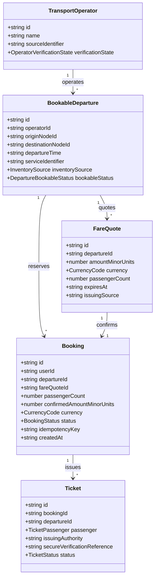
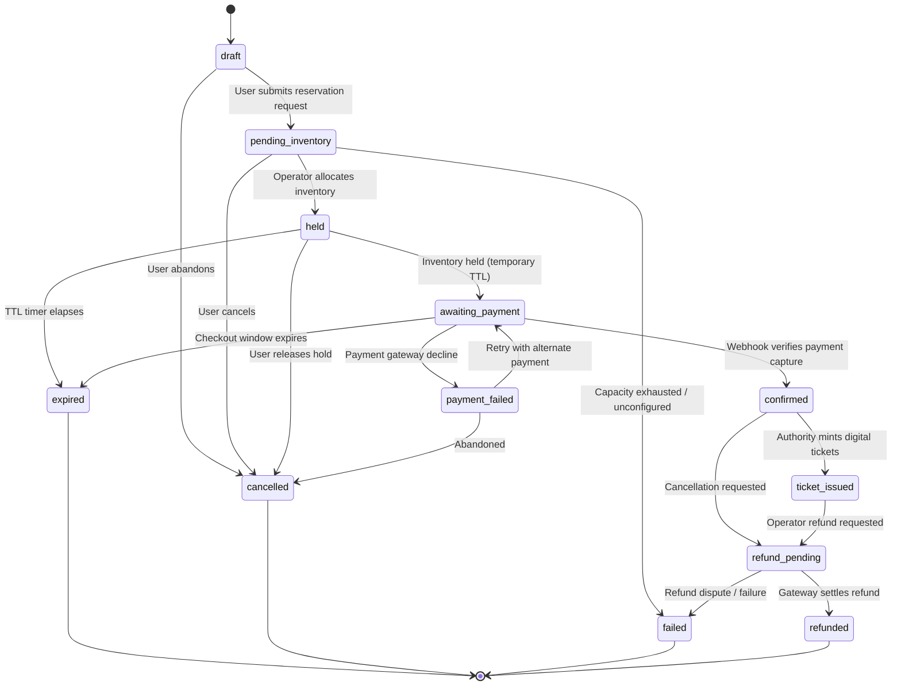

# Waymark Mobile — Feature 05: Ticketing, Booking & Payments Architecture
## Feature 05.1 — Booking & Ticketing Architecture Foundation

**Document:** `docs/architecture/FEATURE_05_BOOKING_ARCHITECTURE.md`  
**Milestone:** Feature 05 — Ticketing, Booking & Payments  
**Subfeature:** 05.1 — Booking & Ticketing Architecture Foundation  
**Owner:** Sathu (`sathurjanv.23@uom.lk`)  
**Reviewer:** Janu (`karunakaranj.23@uom.lk` / `januka-karunakaran`)  
**Status:** DRAFTED · ARCHITECTURE FOUNDATION  
**Date:** November 26, 2026  

---

## 1. Feature Objectives

Feature 05 introduces transactional booking, ticket reservation, and payment processing capabilities to the Waymark mobile ecosystem. The primary objective of Subfeature 05.1 is to establish a rigorous, strongly typed, and secure **domain architecture foundation** prior to building interactive booking user interfaces or processing real financial transactions.

Core principles:
- **Zero Client-Controlled Authority:** The mobile client is an untrusted node. Authoritative pricing, inventory holds, state transitions, and ticket minting must be managed strictly by trusted server/database boundaries.
- **Monetary Precision:** All financial calculations strictly adhere to non-negative integer minor units (e.g. cents) under standard ISO 4217 currency codes to eliminate floating-point arithmetic errors.
- **Strict State Machine:** Explicit booking lifecycle modeling (`draft` → `pending_inventory` → `held` → `awaiting_payment` → `confirmed` → `ticket_issued`) preventing illicit state elevation.
- **Safe Fallback by Default:** Production environments without active, verified operator integrations safely fall back to `UnavailableBookingService` and `NOT_CONFIGURED` status codes, strictly preventing fabricated confirmations or phantom tickets.
- **Truthful Data Provenance:** Simulated discovery corridors and sample routes are segregated from verified bookable departures.

---

## 2. Current Repository Audit

A comprehensive repository audit of the latest `main` codebase (post Feature 04.5) reveals:

| Capability Area | Current Status in Repository | Evidence / File Location |
| :--- | :--- | :--- |
| **Authentication & Profile** | Active Supabase Auth & Profile RLS | `mobile/src/features/auth/`, `mobile/src/features/profile/` |
| **Transport Discovery & Home** | Verified illustrative sample data (`isSample: true`) | `mobile/src/features/home/data/homeContent.ts`, `mobile/src/types/transit.ts` |
| **Journey Screen** | Contextual route timeline & disclaimer | `mobile/app/(tabs)/journey.tsx` (Demarcation: "LIVE ITINERARY IN FEATURE 05") |
| **Ticketing Domain Models** | Established in Feature 05.1.1 | `mobile/src/features/booking/types/` |
| **Database Booking Schema** | None (Profiles/Saved Places only) | `supabase/migrations/20261121000000_waymark_user_profile_foundation.sql` |
| **Real Operator APIs** | Not configured | Production service returns `NOT_CONFIGURED` |
| **Payment Gateway** | None integrated | To be architected in 05.4 (Stripe/Payment Sheet) |
| **Ticket Issuance Engine** | None active | Tickets require authorized issuing references |

---

## 3. Known Backend Availability & Environment Constraints

Waymark Mobile connects to Supabase for authentication and profile preferences. However, the presence of a Supabase PostgreSQL instance does **not** imply active transit booking infrastructure:
- No transport operator APIs (GTFS-RT, SIRI, airline NDC, or proprietary rail reservation protocols) are presently connected.
- No payment gateway merchant accounts or webhook listeners are deployed.
- Consequently, all booking mutation attempts in production MUST be intercepted by safe unavailable adapters (`UnavailableBookingService`) returning explicit `NOT_CONFIGURED` or `INVENTORY_UNAVAILABLE` results until Feature 05.3 and 05.4 are verified.

---

## 4. Operator Integration Status & Provenance Boundaries

Waymark 2100 features simulated futuristic transit corridors (e.g. Kandy Central Maglev Terminal, Bandaranaike Skyport). These corridors are designed for multimodal exploration.

Provenance tiers:
1. `sample_data`: Illustrative schedules, corridors, and simulated departure times displayed for user discovery in Feature 03. Must never be submitted as authoritative booking departures.
2. `operator_verified`: Real-time departures supplied by a verified, contracted transport provider. Requires valid `operatorId`, non-expired departure timestamp, and authenticated inventory hold.
3. `provider_unavailable`: Explicit status returned when an operator integration is unreachable, degraded, or not configured.

---

## 5. Domain Model



---

## 6. Monetary & Fare Model

- **Minor Unit Integrity:** All fares are stored and processed as integer minor units (`amountMinorUnits`). For USD, EUR, LKR, 1 unit equals 1 cent (e.g., $25.00 is represented strictly as `2500`).
- **Floating-Point Prohibition:** Floating-point representations (`25.00`) are prohibited in domain models, service methods, and database columns to eliminate round-off errors.
- **ISO 4217 Standard:** Currencies must be uppercase 3-letter codes (`USD`, `EUR`, `GBP`, `LKR`, `JPY`, etc.).
- **Quote Expiration:** Fare quotes include an explicit `expiresAt` ISO 8601 timestamp. Quotes must be re-validated prior to inventory allocation and payment intent generation.

---

## 7. Reservation State Machine



---

## 8. Booking Service Interfaces

The primary contract governing client-server booking interactions is defined in `BookingService.ts`:

```typescript
export interface BookingService {
  getBooking(bookingId: string): Promise<BookingResult<Booking>>;
  requestReservation(request: BookingRequest): Promise<BookingResult<Booking>>;
  cancelReservation(bookingId: string, reason?: string): Promise<BookingResult<Booking>>;
  getTickets(bookingId: string): Promise<BookingResult<Ticket[]>>;
}
```

The production fallback implementation `UnavailableBookingService` satisfies this contract by returning typed `BookingError` objects with `code: 'NOT_CONFIGURED'` without producing phantom data or writing mock records.

---

## 9. Security & Trust Boundaries

1. **Client Untrusted Boundary:**
   - The mobile client cannot specify `confirmedAmountMinorUnits` or `totalPrice`.
   - The mobile client cannot supply a `userId` parameter to claim ownership of arbitrary bookings.
2. **Idempotency Defense:**
   - Every reservation mutation mandates an `idempotencyKey` (16–128 characters).
   - Server-side deduplication guarantees network retries do not trigger duplicate seat allocations or double charges.
3. **No Card Data Storage:**
   - Credit card numbers (PAN), CVVs, and magnetic stripe tracks must NEVER touch client state, logs, or Waymark databases (PCI-DSS Scope Minimization).
   - Direct payment processing will occur exclusively through tokenized native sheets (e.g. Apple Pay, Google Pay, Stripe SDK).

---

## 10. Authentication & Profile Dependencies

- Reservations mandate an authenticated traveler identity (`userId` referencing Supabase `auth.users(id)`).
- Anonymous guests can browse departures and obtain fare quotes, but requesting a reservation triggers an authentication challenge.
- Row Level Security (RLS) ensures users can query and cancel only their own bookings (`auth.uid() = user_id`).

---

## 11. Future Database Responsibilities (Feature 05.3)

In Feature 05.3, PostgreSQL tables with RLS policies will be introduced:
- `bookable_departures`: Verified departure catalog.
- `departure_inventory`: Authoritative capacity tracking with non-negative constraints (`available_seats >= 0`).
- `booking_reservations`: Idempotent reservation ledger.
- Double-booking prevention via conditional row-level locking (`SELECT ... FOR UPDATE`) or atomic balance decrements.

---

## 12. Future Payment Responsibilities (Feature 05.4)

In Feature 05.4, payments architecture will establish:
- Secure Payment Intent creation on backend.
- Ephemeral client secret passed to mobile payment sheet.
- Asynchronous webhook confirmation (HMAC signature verification).
- Replay-safe payment reconciliation.
- Client redirect status treated solely as informational until webhook confirmation is logged.

---

## 13. Digital Ticket Issuance Authority (Feature 05.5)

- Digital tickets are issued exclusively after confirmed payment capture.
- Each ticket contains an authoritative `issuingAuthority` and a cryptographic `secureVerificationReference`.
- Visual QR codes rendered on mobile screens represent signed, verifiable payload digests, not arbitrary client-side UUIDs.

---

## 14. Prototype Limitations & Demarcation

- **Simulated Transit Corridors:** Static schedules in Feature 03 remain active for discovery and exploration.
- **Unavailable Service:** `UnavailableBookingService` is active. No real reservations can be submitted or confirmed.
- **No Live Fares:** Displayed credits in Journey (`fareCredits`) are illustrative sample values, not official legal quotes.

---

## 15. Feature 05 Implementation Roadmap

| Subfeature | Milestone Target | Key Architectural Deliverable |
| :--- | :--- | :--- |
| **05.1** | Architecture Foundation (Current) | Domain contracts, state machine, minor-unit fare validation, unavailable service |
| **05.2** | Catalog & Booking UI | Departure list, seat selection UI, fare display, booking readiness flags |
| **05.3** | Reservation Engine & Database | Supabase SQL schema, RLS policies, atomic inventory hold, idempotency ledger |
| **05.4** | Payments & Secure Checkout | Server-side payment intent, client payment sheet, webhook reconciliation |
| **05.5** | Digital Tickets & Final QA | Cryptographic ticket issuance, boarding pass passbook, booking history, final QA |
