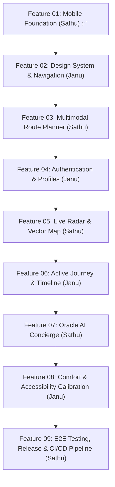

# Waymark 2100 — Website-to-Mobile Migration Plan

**Feature Owner:** Sathu (`sathurjanv.23@uom.lk`)  
**Collaborator:** Janu (`karunakaranj.23@uom.lk`)  
**Target Milestone:** Feature 01 ➔ Feature 09 Roadmap  
**Target Branch:** `develop`

---

## 1. Migration Strategy Overview

The Waymark 2100 mobile transformation follows a **Phased Modular Migration** model. The original website in `src/`, `public/`, and `index.html` remains functional throughout all phases. Each feature package delivers native functionality into `mobile/`, gradually migrating and expanding the prototype into a production planetary transit suite.

---

## 2. Feature Implementation Sequence

---

## 3. Detailed Feature Breakdown & Handoff Schedule

### Feature 01: Mobile Foundation & Repository Audit (Sathu) — COMPLETED
* **Delivered:**
  * Complete audit of existing web repository (`docs/architecture/EXISTING_PROJECT_AUDIT.md`).
  * Expo SDK 52, React Native 0.76, strict TypeScript workspace in `mobile/`.
  * Night Transit theme tokens (`src/theme/`) directly mapped from `DESIGN.md`.
  * Safe layout primitives (`ScreenWrapper`), loading, error, empty states.
  * Resilient API client (`ApiClient`), token injection hooks, and timeout handling.
  * Hardware secure storage (`SecureStorageService`).
  * Real-time network detection (`useNetworkStatus`, `NetworkStatusBanner`).
  * Global error boundary (`ErrorBoundary`).
  * 100% passing unit tests (32 tests across 12 suites).
  * GitHub Actions CI pipeline (`.github/workflows/mobile-ci.yml`).

---

### Feature 02: Design System & Navigation Experience (Janu) — NEXT
* **Assigned To:** Janu (`karunakaranj.23@uom.lk`)
* **Scope & Responsibilities:**
  * Build out full native component library using the tokens in `mobile/src/theme/`.
  * Implement polished bottom tab navigation bar styling and transitions in `mobile/app/(tabs)/_layout.tsx`.
  * Implement interactive buttons (`PrimaryButton`, `SecondaryButton`, `IconButton`) with 2100 luminous borders and press states.
  * Implement segmented controls (`SegmentedControl`) for view switching.
  * Integrate custom Lexend fonts if needed via `@expo-google-fonts/lexend`.
* **Handoff from Feature 01:**
  * Clean route scaffolding already in place in `mobile/app/(tabs)/`.
  * Theme constants (`colors`, `typography`, `spacing`) available at `@/theme`.

---

### Feature 03: Autonomous Route Planner & Place Nodes (Sathu)
* **Assigned To:** Sathu (`sathurjanv.23@uom.lk`)
* **Scope & Responsibilities:**
  * Native search input with keyboard-avoiding views for destination node selection.
  * Quick-place node grid (Home, Work, Kandy, Colombo, Airport) with haptic feedback.
  * Suggested route cards with departure countdown timers.
  * Voice query trigger button integration.

---

### Feature 04: Authentication & Commuter Profiles (Janu)
* **Assigned To:** Janu (`karunakaranj.23@uom.lk`)
* **Scope & Responsibilities:**
  * Secure commuter identity login / registration flow.
  * Connect session tokens to `SecureStorageService` and `ApiClient.setTokenProvider`.
  * User profile management and transit credit balance (`Cr`) viewing.

---

### Feature 05: Live Radar & Vector Map (Sathu)
* **Assigned To:** Sathu (`sathurjanv.23@uom.lk`)
* **Scope & Responsibilities:**
  * Replace static web SVG with native scalable vector map or Mapbox/React Native Maps.
  * Implement live multimodal corridor overlays (Coral for Bus, Teal for Maglev, Sky for Air).
  * Real-time GPS coordinate telemetry HUD and speed readouts.
  * List view toggle with real-time transit status indicators.

---

### Feature 06: Active Mission Journey & Turn-by-Turn Guidance (Janu)
* **Assigned To:** Janu (`karunakaranj.23@uom.lk`)
* **Scope & Responsibilities:**
  * Multi-leg route mission viewer (`Route-A`).
  * "Do This Next" immediate action cards with step-by-step guidance.
  * Native vertical timeline connecting transfer nodes (Walk ➔ Bus ➔ Air Shuttle).
  * Step-free verification badges.

---

### Feature 07: Oracle AI Transit Concierge (Sathu)
* **Assigned To:** Sathu (`sathurjanv.23@uom.lk`)
* **Scope & Responsibilities:**
  * Conversational chat UI for transit inquiries.
  * Suggested prompt pills (*"When do I arrive?"*, *"Find a quieter option"*).
  * Integration with transit AI backend or mock conversational engine.
  * Emergency human dispatcher connection trigger.

---

### Feature 08: Comfort & Sensory Calibration (Janu)
* **Assigned To:** Janu (`karunakaranj.23@uom.lk`)
* **Scope & Responsibilities:**
  * Sensory calibration dashboard: Audio guidance and Quiet boarding native switches.
  * 3-stage information density selector (`Minimal`, `Standard`, `Detailed`).
  * Persistent storage of comfort preferences using local cache.

---

### Feature 09: Release Hardening, E2E Testing & App Store Pipeline (Sathu)
* **Assigned To:** Sathu (`sathurjanv.23@uom.lk`)
* **Scope & Responsibilities:**
  * End-to-end integration testing (Maestro or Detox).
  * Production app bundling for Android (`.aab`) and iOS (`.ipa`).
  * Fastlane / EAS Build CI/CD deployment pipelines.
  * Security penetration audit and final production certification.

---

## 4. Verification & Regression Checklist

For every subsequent feature branch:
- [ ] Existing web application builds cleanly: `npm run build` in root `waymark/`.
- [ ] Mobile TypeScript checks pass: `npm run typecheck` in `mobile/`.
- [ ] Mobile ESLint passes with 0 errors: `npm run lint` in `mobile/`.
- [ ] Mobile unit test suite passes: `npm test` in `mobile/`.
- [ ] Pull Request targets `develop` and includes co-author trailers.
