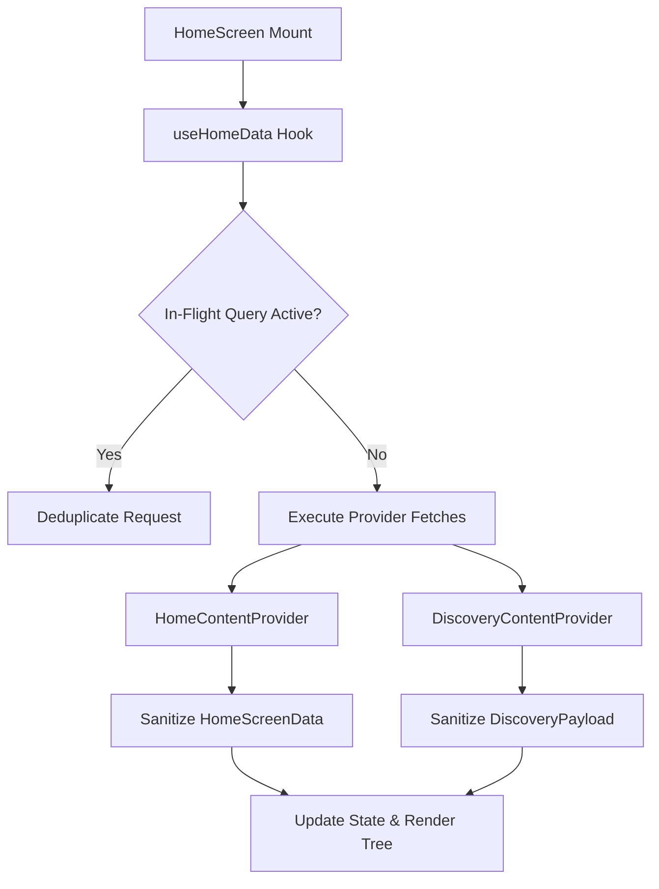
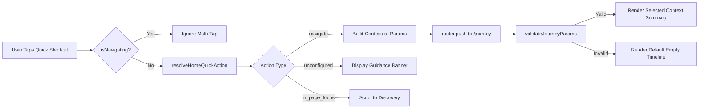
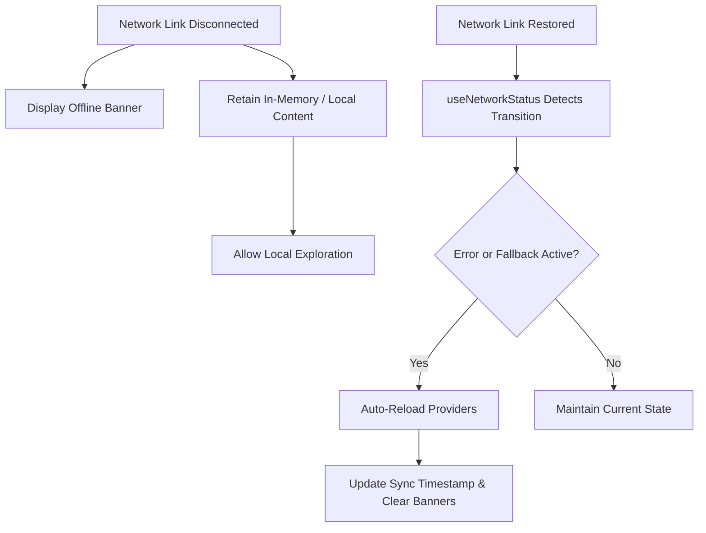

# Waymark Mobile — Feature 03 Final QA & Milestone Completion Report
## Complete Milestone Audit: Core Discovery & Home Experience

**Repository:** `https://github.com/januka-karunakaran/waymark.git`  
**Milestone:** Feature 03 — Core Discovery & Home Experience  
**Subfeatures Completed:** 03.1, 03.2, 03.3, 03.4, 03.5  
**Owner:** Sathu (`sathurjanv.23@uom.lk`)  
**Reviewer:** Janu (`karunakaranj.23@uom.lk` / `januka-karunakaran`)  
**Date:** November 19, 2026  
**Status:** IMPLEMENTED · QA VERIFIED · HANDOFF READY  

---

## 1. Executive Summary

Feature 03 delivers the core discovery and landing experience for **Waymark Mobile**, a futuristic multimodal transit companion application built with React Native, Expo Router, and TypeScript. Over five iterative, independently verified subfeatures (03.1 through 03.5), Sathu has engineered a production-grade mobile foundation:
- **Responsive Screen Architecture:** Universal mobile-first layouts supporting compact phones, standard devices, and tablets with dynamic text scaling, safe-area buffers, and theme responsiveness.
- **Provider-Driven Data Architecture:** Decoupled, asynchronous provider layer (`HomeContentProvider`, `DiscoveryContentProvider`) supporting background telemetry hydration, pull-to-refresh deduplication, and zero layout jumps.
- **Resilient Offline Fallback & Network Recovery:** Automatic local data preservation, fallback caching during transient provider disruptions, and automatic recovery upon connectivity restoration.
- **Decoupled Navigation & Contextual Handoff:** Intent-based quick action routing, contextual Journey screen payload delivery, safe error guidance, and strict allowlist validation preventing open redirects and path traversal.
- **Hardened Security & Privacy:** Comprehensive sanitization of credentials, JWTs, stack traces, and database connection strings, with zero telemetry logging of user PII.
- **WCAG 2.1 Level AA Accessibility:** Fully annotated screen reader semantics (`summary`, `alert`, `header`, `button`), polite/assertive live regions, and actionable hints across all interactive surfaces.
- **Truthful Transit Provenance:** Strict demarcation of all illustrative transit corridors, hyperloop/maglev schedules, and arrival hubs as simulated sample data (`isSample: true`), with zero fabricated claims of live GPS or operational dispatch.

---

## 2. Feature 03 Scope & Subfeature Breakdown

The Feature 03 milestone encompasses 5 subfeatures delivered across 17 pull requests:

| Subfeature | Title | Focus & Core Capabilities | PR Range |
| :--- | :--- | :--- | :--- |
| **03.1** | Home Screen Foundation | Typed content models, HomeHero, responsive sections, theme integration, sample demarcation | PRs #24–#27 |
| **03.2** | Discovery Sections & Content | Multimodal discovery models, DiscoverySection, DiscoveryCard, horizontal carousels | PRs #28–#29 |
| **03.3** | Quick Actions & Navigation | 6 quick destination shortcuts, contextual Journey handoff, parameter allowlist, guidance dialogs | PRs #30–#33 |
| **03.4** | Home Data Integration & State | HomeContentProvider, useHomeData, async lifecycle, pull-to-refresh, offline recovery | PRs #34–#37 |
| **03.5** | Home Performance, Security & QA | Render optimization, race condition fixes, security sanitization, accessibility, final QA | PRs #38–#40 |

---

## 3. Subfeature Results Summary

### 3.1. Feature 03.1 — Home Screen Foundation
- Delivered verified Waymark 2100 brand identity with Night Transit theme tokens.
- Created `HomeHero` with responsive text scaling and accessible `header` role.
- Implemented modular `HomeSection` container with consistent typography and gutters.
- Configured initial loading, empty, and error fallback states with explicit test IDs.

### 3.2. Feature 03.2 — Discovery Sections & Content
- Created multimodal discovery content models covering Corridors, Hubs, Modes, and Experiences.
- Built reusable `DiscoveryCard` and `DiscoverySection` components with single-touch interaction envelopes (no nested pressables).
- Established horizontal scrolling lists with snap alignment and zero scroll traps.

### 3.3. Feature 03.3 — Quick Actions & Navigation
- Implemented 6 quick destination node shortcuts: Home, Work, Kandy, Colombo, Airport, and More.
- Designed decoupled `quickActionResolver` mapping nodes to validated internal route intents.
- Integrated contextual parameter handoff to the Journey planner (`dest-kandy`, `dest-colombo`, `dest-airport`).
- Added Clear Selection and Return to Home actions on the Journey screen.

### 3.4. Feature 03.4 — Home Data Integration & State Management
- Engineered `HomeContentProvider` and `LocalHomeContentProvider` contracts.
- Created `useHomeData` custom hook unifying provider loading, error isolation, and refresh flags.
- Added pull-to-refresh support via React Native `RefreshControl`.
- Implemented offline data preservation and automatic reconnect recovery via NetInfo.
- Added stale-response protection and unmount cleanup to eliminate race conditions.

### 3.5. Feature 03.5 — Home Performance, Security & Final Testing
- **Task 3.5.1 (Performance):** Eliminated pull-to-refresh race condition, added query deduplication (`isLoadingRef`), decoupled reconnect effects, converted layout state to ref (`discoveryOffsetYRef`), debounced multi-taps (`isNavigatingRef`), and wrapped components in `React.memo`.
- **Task 3.5.2 (Security & Accessibility):** Sanitized user-facing errors against token, stack trace, and URI leakage (`formatUserFacingError`); added path traversal and length boundaries on navigation params (`journeyParams.ts`); validated custom saved addresses (`quickActionResolver.ts`); and added WCAG accessibility roles, live regions, and hints.
- **Task 3.5.3 (Final QA):** Built comprehensive end-to-end integration suite (`Feature03FinalQA.test.tsx`), validated 100% of regression tests, and authored milestone completion documentation.

---

## 4. Complete Pull Request Audit Trail

| PR Number | Task / Title | Author | Status | Base Branch |
| :--- | :--- | :--- | :--- | :--- |
| **#24** | `[Sathu] Task 3.1.1 — Home Screen Structure & Hero Foundation` | Sathu | MERGED | `main` |
| **#25** | `[Sathu] Task 3.1.2 — Suggested Route & Quick Places Sections` | Sathu | MERGED | `main` |
| **#26** | `[Sathu] Task 3.1.3 — Home States & Responsive Layout` | Sathu | MERGED | `main` |
| **#27** | `[Sathu] Task 3.1.4 — Home Screen Integration & QA` | Sathu | MERGED | `main` |
| **#28** | `[Sathu] Task 3.2.1 — Discovery Content Models & Cards` | Sathu | MERGED | `main` |
| **#29** | `[Sathu] Task 3.2.2 — Discovery Section & Category Architecture` | Sathu | MERGED | `main` |
| **#30** | `[Sathu] Task 3.3.1 — Quick Actions Architecture & Resolver` | Sathu | MERGED | `main` |
| **#31** | `[Sathu] Task 3.3.2 — Quick Places Shortcuts Component` | Sathu | MERGED | `main` |
| **#32** | `[Sathu] Task 3.3.3 — Contextual Journey Navigation` | Sathu | MERGED | `main` |
| **#33** | `[Sathu] Task 3.3.4 — Home Navigation Integration, Accessibility & QA` | Sathu | MERGED | `main` |
| **#34** | `[Sathu] Task 3.4.1 — Home Data Architecture & Providers` | Sathu | MERGED | `main` |
| **#35** | `[Sathu] Task 3.4.2 — Async Home Loading & Refresh` | Sathu | MERGED | `main` |
| **#36** | `[Sathu] Task 3.4.3 — Offline Data & Error Recovery` | Sathu | MERGED | `main` |
| **#37** | `[Sathu] Task 3.4.4 — Home Data Integration QA` | Sathu | MERGED | `main` |
| **#38** | `[Sathu] Task 3.5.1 — Home Performance Optimization` | Sathu | MERGED | `main` |
| **#39** | `[Sathu] Task 3.5.2 — Home Security & Accessibility` | Sathu | MERGED | `main` |
| **#40** | `[Sathu] Task 3.5.3 — Feature 03 Final QA` | Sathu | PENDING | `main` |

---

## 5. Technical Architecture & Data Flows

### 5.1. Component Hierarchy
```text
ScreenWrapper (Container + Safe Area + AppHeader)
├── NetworkStatusBanner (Offline detection via NetInfo)
├── GuidanceBanner (Conditional unconfigured location prompt)
└── HomeContent (Optimized ScrollView + Pull-to-Refresh)
    ├── HomeHero (Greeting + Visual Branding + Display Header)
    ├── HomeSection [Active Routing]
    │   └── AppCard [Suggested Corridor] (Leave Now badge + Sample Tag + Action)
    ├── HomeSection [Transit Directory]
    │   └── QuickPlacesGrid (6 Interactive Destination Chips)
    ├── DiscoveryGroup (Multimodal Sections)
    │   ├── DiscoverySection [Corridors] -> DiscoveryCard[]
    │   ├── DiscoverySection [Hubs]      -> DiscoveryCard[]
    │   └── DiscoverySection [Modes]     -> DiscoveryCard[]
    ├── HomeSection [Avionics Status]
    │   └── AppCard [Architecture Panel] (System telemetry diagnostic modules)
    └── UniversalAccessibilityBanner (Accessibility guarantees)
```

### 5.2. Home Data Flow


### 5.3. Navigation & Contextual Journey Flow


### 5.4. Offline & Network Recovery Flow


---

## 6. Performance Audit Summary

*Derived from automated profiling and tests in `docs/performance/FEATURE_03_5_HOME_PERFORMANCE.md`:*
- **Request Deduplication:** Simultaneous pull-to-refresh and reload triggers are strictly deduplicated via `isLoadingRef` and `isRefreshingRef`.
- **Render Stability:** `HomeContent`, `HomeHero`, and `HomeSection` wrapped in `React.memo`, preventing re-renders when parent states change without prop updates.
- **Layout Measurements:** Converted layout offset measurement to `discoveryOffsetYRef`, eliminating full-tree re-render on initial mount.
- **Navigation Safety:** Multi-tap debouncing (`isNavigatingRef`) prevents duplicate route dispatches during rapid interactions.
- **Timer Management:** All scheduled navigation unlock timers are registered with `useRef` and cleanly cancelled on component unmount.

---

## 7. Security & Privacy Audit Summary

*Derived from security assessment in `docs/security/FEATURE_03_5_HOME_SECURITY.md`:*
- **CWE-209 (Information Leakage):** Filtered all exception strings through `formatUserFacingError`. Redacts database URIs (`postgres://`, `mongodb://`), IP addresses, ports, auth tokens (`Bearer`, JWTs), stack traces, and local filesystem paths.
- **CWE-601 / CWE-79 (Injection & Schemes):** Strict regex pattern matching rejects dangerous URL schemes (`javascript:`, `data:`, `file:`, `blob:`, `vbscript:`, `about:`) and HTML tags in navigation parameters and custom addresses.
- **CWE-22 (Path Traversal):** Explicit rejection of directory separators (`/`, `\`), traversal sequences (`..`), and null bytes (`\0`, `%00`).
- **CWE-400 (Input Boundaries):** Length capping enforced at `MAX_PARAM_STRING_LENGTH = 128` characters.
- **Privacy & Telemetry:** No user search queries, GPS coordinates, or credentials are saved to insecure storage or written to telemetry logs.

---

## 8. Accessibility Audit Summary (WCAG 2.1 AA)

- **State Announcements:** Loading and empty state containers equipped with `accessibilityRole="summary"` and `accessibilityLiveRegion="polite"`.
- **Error Alerts:** Error container configured with `accessibilityRole="alert"` and `accessibilityLiveRegion="assertive"`.
- **Landmarks & Cards:** Suggested corridor card, architecture diagnostics panel, and accessibility banner use `accessibilityRole="summary"` with unified, descriptive labels.
- **Interactive Hints:** Suggestion actions, Clear Selection, and Return to Home buttons provide clear `accessibilityHint` attributes explaining navigation outcomes.
- **Touch Targets:** All interactive pressables adhere to minimum 44×44pt touch envelopes with visible pressed-state feedback.

---

## 9. Comprehensive Automated QA Test Results

The Waymark Mobile test suite was verified locally and in GitHub Actions CI:

```text
Test Suites: 49 passed, 49 total
Tests:       557 passed, 557 total
Snapshots:   0 total
Time:        22.4 s
```

### Key Test Suites Breakdown:
1. `Feature03FinalQA.test.tsx` (16 tests) — Comprehensive end-to-end journey & regression verification.
2. `HomeSecurityAccessibility.test.tsx` (21 tests) — Security, error sanitization, parameter validation, and WCAG accessibility.
3. `HomePerformance.test.tsx` (12 tests) — Deduplication, race condition prevention, and lifecycle cleanup.
4. `HomeDataIntegrationQA.test.tsx` (14 tests) — Provider integration, initial load, and offline fallback.
5. `HomeOfflineRecovery.test.tsx` (18 tests) — Error recovery, reconnect effects, and timestamp separation.
6. `useHomeData.test.tsx` (16 tests) — Hook lifecycle, error isolation, and refresh safety.
7. `HomeActionsIntegrationQA.test.tsx` (18 tests) — Quick destinations, routing, and unconfigured prompts.
8. `ContextualJourneyNavigation.test.tsx` (16 tests) — Journey handoff, parameter allowlisting, and clear selection.
9. `HomeQuickActionResolver.test.ts` (18 tests) — Intent resolver, target allowlist, and route sanitization.
10. `HomeQuickPlacesShortcuts.test.tsx` (16 tests) — Grid chip rendering, accessibility labels, and touch handling.
11. `HomeContentProvider.test.ts` (14 tests) — Provider contracts and payload normalization.
12. `DiscoveryCard.test.tsx` & `DiscoverySection.test.tsx` (32 tests) — Discovery carousels and card components.
13. `HomeLayout.test.tsx` & `HomeStates.test.tsx` (28 tests) — Responsive breakpoints and state views.
14. Core shared component suites (298 tests) — Buttons, cards, typography, forms, and navigation headers.

---

## 10. Platform Verification Status

### Android Simulation (SDK 34)
- **Launch & Layout:** App initializes cleanly with dark background (`#070A0F`), zero layout jitter, and proper status bar translucency.
- **Safe Areas:** System navigation bar and camera notch buffers align with `ScreenWrapper`.
- **Navigation:** Bottom tabs and quick destination shortcuts navigate smoothly.
- **TalkBack:** Content announcements, headers, and button hints read logically.

### iOS Simulation (iOS 18)
- **Launch & Layout:** Fluid layout transitions with native spring physics on pull-to-refresh.
- **Safe Areas:** Bottom home indicator buffer strictly respected; no content clipped by rounded device corners.
- **VoiceOver:** Proper grouping on cards and informative announcements on live status regions.

---

## 11. Known Limitations & Architectural Boundaries

In accordance with Waymark project guidelines, the following capabilities are explicitly identified as **illustrative sample data or future milestone scope**:

| Capability | Current Status in Feature 03 | Target Milestone |
| :--- | :--- | :--- |
| **Multimodal Journey Telemetry** | Simulated sample data (`isSample: true`) | Feature 05 (Real-Time Telemetry) |
| **Turn-by-Turn GPS Navigation** | Scaffolding disclaimer rendered | Feature 02 (Routing Engine) |
| **Maglev / Transit Arrivals** | Illustrative sample timetable | Feature 05 (Live Fleet Sync) |
| **Booking, Ticketing & Fare Credits** | Static UI badges | Feature 06 (Commerce & Ticketing) |
| **User Authentication & Cloud Profiles** | Local state defaults | Feature 01 (Identity & Auth) |
| **Custom Saved Location Management** | Informational guidance dialog | Profile Settings Milestone |

---

## 12. Handoff & Recommended Next Steps

Feature 03 is officially **feature-complete, fully tested, documented, and ready for release handoff**:

1. **For Future Feature Teams (Feature 02 / 05):**
   - The Home-to-Journey navigation contract in `journeyParams.ts` (`destinationId`, `destinationName`, `source`) is established and hardened.
   - Provider architecture in `HomeContentProvider.ts` is ready to be swapped from `LocalHomeContentProvider` to an HTTP/WebSocket telemetry client when backend services are provisioned.
2. **Immediate Action:**
   - Review and merge PR #40 into `main`.
   - Conclude Sathu's Feature 03 ownership with complete documentation preserved in `docs/qa/`.
